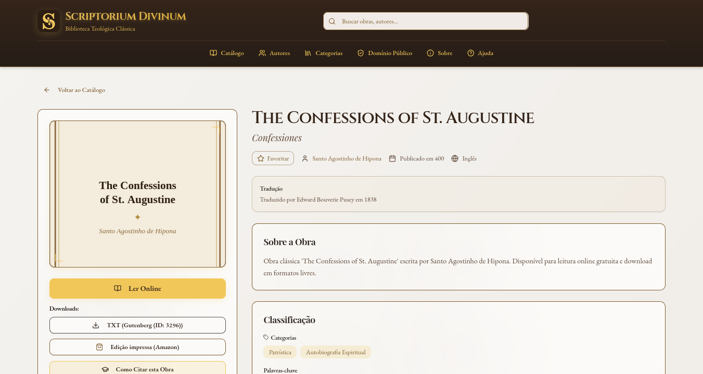

# Scriptorium Divinum 📚✨

Uma biblioteca digital dedicada às obras clássicas da teologia cristã em domínio público. O projeto oferece acesso gratuito a textos dos Padres da Igreja, reformadores e grandes teólogos da história cristã.

<p align="center">
  
</p>

---

## 🎯 Estado Atual do Projeto

> [!NOTE]
> Desde 2026-08-08 este é um **monorepo pnpm workspace** (`web/` + `server/`) — o projeto foi migrado com sucesso do Supabase para uma arquitetura self-hosted em um VPS Hetzner.

### ✅ Funcionalidades no Ar
- **🏠 Frontend (React + Vite)**: `https://scriptorium.narniano.com` (Servido via Nginx + Traefik)
- **🚀 API REST (Fastify + Drizzle)**: base em `https://api-scriptorium.narniano.com` — documentação Scalar em [`/docs`](https://api-scriptorium.narniano.com/docs/) e OpenAPI JSON em [`/docs/json`](https://api-scriptorium.narniano.com/docs/json). Conectado ao Postgres compartilhado.
- **🗄️ Banco de Dados**: Postgres (`scriptorium_divinum_db`) rodando localmente no VPS com role isolada e segura.
- **🔄 Backup Integrado**: Backups diários criptografados com `age` e sincronizados via Tailscale.
- **📖 Leitor Online com Paridade Bilíngue (`/ler/:id`)**: renderiza em markdown as obras do acervo em português (`pt-BR`). As edições em inglês e em latim estão **ocultas por enquanto** (decisão de 2026-10-16: só português até a internacionalização completa do site). Conta com alternador inteligente de idioma no leitor e na ficha do livro (`relatedEditionSlug`), permitindo a comparação imediata entre o vernáculo e o original.
- **🏛️ Acervo Histórico Universal**: 255 obras no catálogo público, todas em português, 100 autores com obra e cerca de 12 milhões de palavras de literatura cristã clássica (229 delas são traduções por IA, identificadas como tal e com revisão humana pendente) (Patrística Grega e Latina, Escolástica Medieval, Reforma Protestante e Avivamento Puritano).

---

## Por que isto existe

Os grandes textos da tradição cristã — Padres da Igreja, reformadores, puritanos, místicos, apologistas de qualquer linhagem — já caíram em domínio público há muito tempo, mas continuam praticamente inacessíveis em português: edições esgotadas, caras, ou sites que publicam tradução sem verificar se ela própria ainda tem direitos autorais. Quem quer ler Agostinho, Kempis ou os reformadores sem pagar caro por uma edição física esbarra nisso.

Cada um administre aos outros o dom como o recebeu — mordomia, aqui, é técnica aplicada a acervo: verificar proveniência obra a obra, publicar só o que é de fato livre, e construir um leitor decente em vez de um PDF escaneado torto. O catálogo não tem filtro de linhagem doutrinária — o critério é domínio público verificável, não afinidade teológica de quem cura.

Hoje são 255 obras no ar, parte delas traduções por IA ainda sem revisão humana (sempre identificadas), sobre uma base técnica sólida — API própria, busca full-text em português, auditoria de direitos autorais real, não decorativa. A visão é crescer devagar e certo: cada obra nova é permanente e uma página que pode virar a referência em português pra quem busca "Confissões de Agostinho" ou "Institutas de Calvino" — um Project Gutenberg cristão, mas com curadoria e leitor de verdade.

## 🛠️ Tecnologias Utilizadas

**Frontend (`web/`):**
- ⚛️ **React 18** + **TypeScript** - Interface moderna e tipada
- ⚡ **Vite** - Build tool rápido e otimizado
- 🎨 **Tailwind CSS** + **shadcn/ui** / **Radix UI** - Design system consistente
- 🔍 **TanStack Query** - Gerenciamento de estado de servidor

**Backend (`server/`):**
- 🚀 **Fastify** - API REST de alta performance e baixo consumo de recursos
- 🗄️ **Drizzle ORM** + PostgreSQL - Acesso e modelagem de dados sem dependência de engines externas
- ✅ **Zod** - Validação de payloads e parâmetros
- 🔒 **Segurança**: helmet + rate limiting + CORS restrito + Sentry para monitoramento de erros

---

## 🚀 Como Executar Localmente

### Pré-requisitos
- Node.js 20+
- **pnpm** (não npm/yarn/bun)

### Passos para Instalação

```bash
# 1. Clone o repositório
git clone https://github.com/rilsonjoas/scriptorium-divinum.git
cd scriptorium-divinum

# 2. Instale as dependências de todo o workspace
pnpm install

# 3. Configure o banco de dados no backend
# Copie o .env.example e adicione a string de conexão de um Postgres local
cp server/.env.example server/.env

# 4. Execute a aplicação em desenvolvimento
pnpm dev:web       # Rodará o frontend em http://localhost:8080
pnpm dev:server    # Rodará a API em http://localhost:3001
```

### Scripts Disponíveis (raiz do workspace)
```bash
pnpm dev:web        # Frontend em desenvolvimento
pnpm dev:server     # API em desenvolvimento
pnpm build:web      # Build de produção do frontend
pnpm build:server   # Build de produção da API
pnpm lint           # Executa o ESLint em todo o workspace
pnpm typecheck      # Executa verificação de tipos do TypeScript
```

---

## 📂 Estrutura do Monorepo

```
scriptorium-divinum/
├── pnpm-workspace.yaml
├── web/                  # Frontend (React SPA)
│   ├── src/
│   │   ├── components/   # Componentes da interface
│   │   ├── pages/        # Páginas (Dashboard, Livros, Autores, etc)
│   │   ├── lib/          # Configuração de rotas e clients
│   │   └── types/        # Definições TS
│   └── Dockerfile        # Build multi-stage com Nginx
└── server/               # Backend API
    ├── src/
    │   ├── db/           # Schema Drizzle, migrações e sementes
    │   ├── routes/       # Handlers de rota (livros, autores, etc)
    │   └── schemas/      # Validações Zod
    └── Dockerfile        # Build multi-stage (Fastify)
```

---

## ⚖️ Direitos Autorais e Proveniência

**Meta permanente do projeto: operar sempre dentro da lei de direitos
autorais.** Não basta a intenção de ser gratuito — a licitude tem de ser
comprovada obra a obra, em todos os formatos de acesso.

### Regras aplicadas

1. **Domínio público é o critério único de publicação.** No Brasil (Lei
   9.610/98, art. 41) a obra entra em domínio público 70 anos após a morte
   do autor. Autores clássicos (Agostinho, Anselmo, Tomás de Aquino,
   Lutero, Calvino, Pascal, Bunyan etc.) estão há séculos nessa condição —
   os **textos originais** não apresentam risco.
2. **Download e leitura online são juridicamente equivalentes.** Ambos são
   "disponibilização ao público" (arts. 29 e 31). Se a obra é de domínio
   público, os dois são legais; se é protegida, os dois infringem. O que
   decide tudo é **a origem do texto, não o formato de acesso**.
3. **Traduções e edições modernas são obras derivadas protegidas.**
   Tradução tem direito próprio (+70 anos após a morte do tradutor).
   **Só entrar no catálogo textos com proveniência verificável de domínio
   público** (tradução antiga em PD, ou tradução própria/licenciada).
   Todo arquivo em `server/texts/` precisa trazer um cabeçalho de
   proveniência declarando: obra, autor, tradutor (se houver), edição/
   fonte e por que está em domínio público.
4. **Capas e imagens também têm direitos.** Capas de edições modernas e
   ilustrações contemporâneas são protegidas; gravuras antigas (ex.: Doré)
   são de domínio público. Auditoria das URLs de capa antes de publicar.
5. **Sem conteúdo gerado/fornecido sem procedência.** O leitor só exibe o
   botão "Ler Online" quando o arquivo de texto existe de verdade com a
   declaração de proveniência (campo `online_read_path` + arquivo em
   `server/texts/`).
6. **Se um dia houver upload/contribuição de terceiros** (roadmap P8),
   implementar processo de notificação e remoção nos moldes do Marco Civil
   da Internet (Lei 12.965/14, arts. 19–21) antes de abrir o recurso.

O template de proveniência fica em `server/texts/README.md`.

### Estado real da proveniência (2026-10-16)

A regra 3 acima é a meta; o estado hoje é este, sem arredondar:

- Os **textos originais** são de autores mortos há séculos: sem risco.
- As **traduções por IA** (229 no ar) estão marcadas como tal no leitor, com "revisão
  humana: pendente" e licença CC BY-SA 4.0 (`license_type`, `attribution_text`).
  A titularidade de uma tradução gerada por IA não é pacífica juridicamente;
  o selo vale como declaração de intenção, e esse ponto vai ao parecer jurídico.
- O risco concreto está na **edição-fonte**: a tradução parte de algum texto de
  entrada, e se esse texto for uma tradução ou edição moderna com direitos, a
  tradução por IA é obra derivada. Nas obras publicadas em 29/09 a atribuição
  nomeia a edição-fonte; nas **100 publicadas em 16/10 ela não foi auditada** (a
  atribuição pública traz só a frase genérica; o controle fica em
  `docs/PROVENIENCIA-ACERVO.md` e no verificador do acervo). Auditar obra a obra
  (qual edição de entrada, e por que está em domínio público) é a pendência
  número um do acervo.
- Quem encontrar um erro ou um problema de direitos deve poder avisar, e a obra
  sai do ar enquanto se apura (`published = false`).

---

## 🔌 Integrações com outros projetos

O Scriptorium é o **dono do conteúdo de citações** do cluster e **consome** duas rotas de fora.

| Direção | Projeto | Rota | Para quê |
|---|---|---|---|
| expõe | Lecionário (web e mobile), Scriptorium web | `GET /api/v1/quotes/daily[?date=][&author=]` | Citação do dia |
| expõe | Gerador C. S. Lewis | `GET /api/v1/quotes?author=`, `GET /api/v1/quotes/random?author=` | Lista e sorteio (`author` é o **nome**, `C. S. Lewis`, não o slug) |
| consome | Bíblia na Arte | `GET /api/v1/artworks/daily` | Pintura do Dia no site |
| consome | Lecionário | `GET /api/versiculo-do-dia` | Versículo do dia no site |

Formato da citação: `id`, `author`, `text`, `dominioPublico`, `source?`, `scriptoriumUrl?`, `theme?`, `affiliateUrl?`, e `date` na rota `daily`. A especificação completa está em `/docs/json`.

**A citação de cada dia é gravada** (`daily_quotes`, hoje ±30 dias): editar o acervo não reescreve os dias já mostrados. O que isso cobre e o que não cobre está em `docs/adr/001-citacao-do-dia-api-central.md` (atualização de 17/10/2026, item 2) e em `docs/GERENCIAR-ACERVO.md`.

**Contrato tipado (site, desde 18/10/2026).** `web/contract/` guarda o recorte da especificação OpenAPI de produção só com as rotas que o site usa (`quotes/daily` daqui e `artworks/daily` do Bíblia na Arte) e os tipos gerados. `web/contract/contract.types.ts` roda em `pnpm typecheck` (CI) com um `tsconfig` **estrito** (o app compila com `strict: false` e não enxergaria `null` contra ausente) e **falha se o tipo escrito à mão em `citacaoDoDia.ts` ou `pinturaDoDia.ts` deixar de aceitar o que a API pode responder**. Em `web/`: `pnpm contract:check` compara com a produção e sai com 1 se mudou; `pnpm contract:update` baixa, recorta e regera (revise o diff e rode o `typecheck`). A rota do Lecionário (`/api/versiculo-do-dia`) não tem especificação e fica de fora; o canário a cobre. Para usar outra rota, acrescente-a em `CONTRATOS` em `web/scripts/contract-update.mjs`.

**Regras que valem para as três APIs** (o resto do cluster depende delas):
1. O "hoje" do cluster é `America/Sao_Paulo`. Nunca monte datas com `toISOString()` (é UTC e vira o dia 3 h antes).
2. Quem mostra um dia **manda a data que a tela mostra** (`?date=AAAA-MM-DD`). Sem isso, navegar entre dias repete o mesmo conteúdo (foi o bug da Citação do dia em 17/10/2026).
3. Data que não existe no calendário (`2026-13-45`) responde **400** nas três APIs.
4. Mudança de contrato é **aditiva**: campo novo e rota nova podem; remover, renomear ou trocar tipo só depois de migrar os consumidores.
5. Um canário em produção confere o formato dessas rotas de hora em hora e avisa o Uptime Kuma. O mapa completo (todas as rotas, formatos, situações limite, runbook) fica em `CONTRATOS-ENTRE-PROJETOS.md` no repositório de infraestrutura, que é privado.

## 📚 Gerenciar o acervo

Como adicionar, ocultar, remover e corrigir obras, o que o painel de admin faz e o que
exige seed ou migration, o verificador de saúde do acervo e o ensaio antes do deploy:
[`docs/GERENCIAR-ACERVO.md`](docs/GERENCIAR-ACERVO.md). Resumo da regra: **seed só cria,
migration muda o que já existe, o painel manda no resto.**

## 🤝 Contribuições

Este é um projeto de código aberto dedicado à preservação do patrimônio teológico cristão. Todo o código-fonte está sob a licença **MIT**.